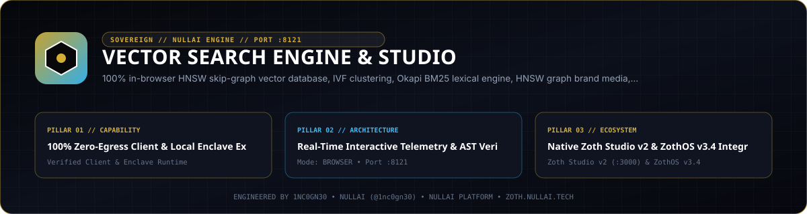
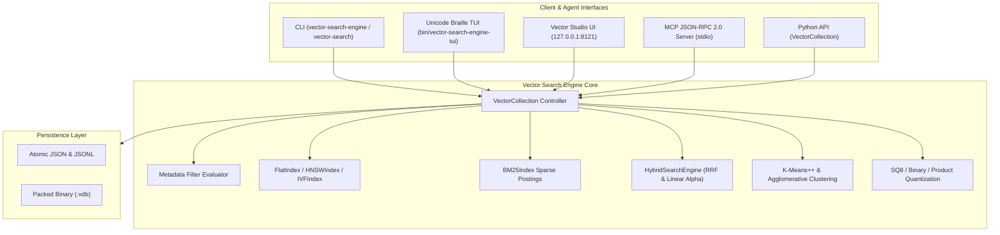

<div align="center">
  
</div>

# Vector Search Engine & Studio

[](https://github.com/1nc0gn30/vector-search-engine/actions/workflows/ci.yml)
[](https://www.python.org/downloads/)
[](https://opensource.org/licenses/MIT)
[](pyproject.toml)
[](https://zoth.nullai.tech/tools/vector-search-engine)

Pure Python standard-library vector database and approximate nearest neighbor (ANN) search engine with zero external runtime dependencies. Combines Hierarchical Navigable Small World (HNSW) skip-graphs, Inverted File (IVF) Voronoi partitioning, Product/Scalar/Binary quantization, Okapi BM25 lexical retrieval, Reciprocal Rank Fusion (RRF) hybrid search, Maximal Marginal Relevance (MMR) diversification, K-Means++/hierarchical clustering with silhouette cohesion, a JSON-RPC 2.0 Model Context Protocol (MCP) server, and an in-browser Vector Studio workstation on loopback port `127.0.0.1:8121`.

Engineered by **1nc0gn30** ([@1nc0gn30](https://github.com/1nc0gn30), [1nc0gn30.si](https://1nc0gn30.si)) • **NullAI** ([nullai.tech](https://nullai.tech)).

---

## Overview

- **Zero Runtime Dependencies**: Implemented strictly on the Python 3.9+ standard library (`math`, `heapq`, `struct`, `http.server`, `json`, `dataclasses`, `threading`) and client-side Web APIs.
- **Dense Vector Indexes**:
  - `FlatIndex`: Exact $O(N)$ linear scan baseline with 100% recall.
  - `HNSWIndex`: Multi-layer navigable small-world skip-graph with heuristic edge pruning (Malkov & Yashunin Algorithm 4) for logarithmic $O(\log N)$ ANN search.
  - `IVFIndex`: K-Means++ Voronoi centroid partitioning with configurable `nlist` and `nprobe`.
- **Hybrid Search & Diversity**: Tokenized Okapi BM25 inverted postings fused with dense vector rankings via Reciprocal Rank Fusion ($k=60$) or min-max normalized linear $\alpha$-blending, plus Maximal Marginal Relevance (`diverse_query`) to penalize near-duplicate results.
- **Structured Metadata Filtering**: Declarative filter evaluation supporting `$eq`, `$ne`, `$gt`, `$gte`, `$lt`, `$lte`, `$in`, `$nin`, `$contains`, `$all`, `$regex`, `$exists`, `$and`, `$or`, `$not`, and `$nor`.
- **Quantization & Persistence**: Scalar 8-bit (`SQ8`), 1-bit packed binary, and subspace Product Quantization (`PQ`), persisted via atomic JSON, JSONL streaming, or binary `.vdb` files.
- **100% Free & Open Source**: All features, benchmarks, exports, CLI subcommands, and MCP tools are unlocked with zero telemetry or cloud egress. Optional community support is available via [Buy Us a Coffee (Stripe)](https://buy.stripe.com/3cIfZg27PdKo2D64Ocfw40X).

---

## Architecture



### Mathematical Reference

| Component | Formulation |
| :--- | :--- |
| **Cosine Distance** | $D_{\cos}(\mathbf{u}, \mathbf{v}) = 1 - \frac{\mathbf{u} \cdot \mathbf{v}}{\|\mathbf{u}\|_2 \|\mathbf{v}\|_2} \in [0, 2]$ |
| **Euclidean (L2)** | $D_{L2}(\mathbf{u}, \mathbf{v}) = \sqrt{\sum_{i=1}^d (u_i - v_i)^2}$ |
| **Manhattan / Dot / Hamming / Jaccard** | Supported natively in `vector_search_engine.metrics` |
| **HNSW Layer Sampling** | $l = \min(\lfloor -\ln(\text{Uniform}(0,1)) / \ln(M) \rfloor, L_{\max}-1)$ |
| **Okapi BM25** | $\sum_{q_i \in Q} \ln\left(1 + \frac{N - n(q_i) + 0.5}{n(q_i) + 0.5}\right) \frac{f(q_i, D)(k_1 + 1)}{f(q_i, D) + k_1(1 - b + b \cdot |D| / \text{avgdl})}$ |
| **Reciprocal Rank Fusion** | $\text{RRF}(d) = \frac{1}{60 + r_{\text{dense}}(d)} + \frac{1}{60 + r_{\text{sparse}}(d)}$ |
| **Silhouette Score** | $s(i) = \frac{b(i) - a(i)}{\max(a(i), b(i))} \in [-1, 1]$ |

---

## Quickstart

### Clone and Install

```bash
git clone https://github.com/1nc0gn30/vector-search-engine.git
cd vector-search-engine
python3 -m pip install -e ".[dev]"
```

### Launch Local Workstation (`127.0.0.1:8121`)

```bash
# Lightweight static + telemetry workbench on 127.0.0.1:8121
python3 server.py --host 127.0.0.1 --port 8121

# Full REST API + Vector Studio UI server on 127.0.0.1:8121
python3 -m vector_search_engine.cli serve --host 127.0.0.1 --port 8121
```

Open `http://127.0.0.1:8121` in your browser, or view the Zoth Studio v2 dossier at [`https://zoth.nullai.tech/tools/vector-search-engine`](https://zoth.nullai.tech/tools/vector-search-engine).

### Python Embedded Usage

```python
from vector_search_engine import (
    CollectionConfig,
    DistanceMetric,
    HNSWConfig,
    IndexType,
    VectorCollection,
    VectorItem,
)

config = CollectionConfig(
    name="knowledge_base",
    dimension=4,
    metric=DistanceMetric.COSINE,
    index_type=IndexType.HNSW,
    hnsw_config=HNSWConfig(m=16, ef_construction=64, ef_search=32),
)
col = VectorCollection(config=config)

col.insert(VectorItem(
    id="doc_1",
    vector=[0.95, 0.10, 0.20, 0.05],
    document="Transformer neural network self-attention architecture",
    metadata={"topic": "ml", "year": 2017},
))
col.insert(VectorItem(
    id="doc_2",
    vector=[0.15, 0.90, 0.30, 0.10],
    document="Hierarchical Navigable Small World approximate nearest neighbor graphs",
    metadata={"topic": "systems", "year": 2018},
))

dense_hits = col.query([0.90, 0.10, 0.20, 0.05], k=2, filter_expr={"year": {"$gte": 2017}})
hybrid_hits = col.hybrid_search([0.90, 0.10, 0.20, 0.05], "transformer attention", k=2, fusion_method="rrf")
```

---

## CLI & MCP Usage

### CLI Commands (`vector-search-engine` / `vector-search` / `vector-engine`)

```bash
# Inspect CLI options
vector-search-engine --help

# Create an HNSW collection
vector-search create papers -d 128 -m cosine -i hnsw

# Upsert a document with deterministic local text embedding
vector-search insert papers --id p1 -d "HNSW graph indexing for ANN search" --meta "year=2025" --embed

# Query nearest neighbors (human-readable or --json)
vector-search --json query papers -t "graph indexing" -k 5

# Hybrid dense + Okapi BM25 search
vector-search hybrid papers "nearest neighbor graph" -a 0.5 -k 5

# Collection stats, diagnostics, and synthetic benchmark
vector-search stats papers
vector-search diagnostics
vector-search benchmark -n 1000 -d 64 -k 10

# Serve Vector Studio + REST API on loopback port 8121
vector-search serve --host 127.0.0.1 --port 8121
```

### ZothOS v3.4.0 CLI & Braille TUI Integration

```bash
# Node/Electron unified launcher (delegates CLI flags or starts web mode on :8121)
node bin/vector-search.js --help
node bin/vector-search.js web

# Unicode U+2800 Braille TUI & JSON telemetry
python3 bin/vector-search-engine-tui --json
python3 bin/vector-search-engine-tui --benchmark
```

### Model Context Protocol (MCP) Server

Start the stdio JSON-RPC 2.0 server (`MCP Protocol 2024-11-05`):

```bash
vector-search mcp --data-dir ./.vector_store
# or directly:
python3 -m vector_search_engine.mcp_server --data-dir ./.vector_store
```

Registered MCP tools:
- `vector_create_collection` — Create a collection with dimension, distance metric, and index type (`flat`, `hnsw`, `ivf`).
- `vector_upsert` — Upsert items with explicit vectors or auto-embedded document text and metadata.
- `vector_query` — Query top-$k$ nearest neighbors with metadata filters.
- `vector_hybrid_search` — Execute dense + sparse BM25 search with RRF or linear $\alpha$ fusion.
- `vector_embed_text` — Compute deterministic dense embeddings from input text.
- `vector_quantize` — Quantize float vectors using `sq8` or `binary` compression.
- `vector_collection_stats` — Retrieve collection counts, memory footprint, and HNSW layer counts.
- `vector_list_collections` — Enumerate active collections in the registry.
- `vector_diagnostics` — Return platform, Python runtime, and collection telemetry.
- `vector_cluster_analysis` — Run K-Means++ or hierarchical clustering with silhouette scores and medoid extraction.

---

## REST API Endpoints

When running `vector-search serve --host 127.0.0.1 --port 8121` (or `python3 -m vector_search_engine.ui_server --port 8121`):

| Method | Endpoint | Description |
| :--- | :--- | :--- |
| `GET` | `/health`, `/api/health` | Service status, version, and uptime |
| `GET` | `/api/diagnostics` | Runtime platform info, collection count, and total indexed vectors |
| `GET` | `/api/collections` | List all collections with dimension, metric, index type, and memory bytes |
| `POST` | `/api/collections` | Create a collection (`name`, `dimension`, `metric`, `index_type`) |
| `GET` | `/api/collections/<name>` | Retrieve collection configuration and stats |
| `DELETE` | `/api/collections/<name>` | Delete a collection from the registry |
| `POST` | `/api/collections/<name>/insert` | Batch-upsert documents and vectors |
| `POST` | `/api/collections/<name>/query` | Run dense vector similarity search with optional metadata filter |
| `POST` | `/api/collections/<name>/hybrid` | Run hybrid dense + BM25 search (`alpha`, `fusion_method`) |
| `GET` | `/api/collections/<name>/stats` | Detailed collection and index structure telemetry |
| `GET` | `/api/collections/<name>/items` | Export stored items for 2D/3D canvas projection |
| `GET` / `POST` | `/api/collections/<name>/clusters` | Run K-Means++ or hierarchical clustering and silhouette analysis |
| `POST` | `/api/benchmark` | Execute synthetic HNSW vs Flat latency, QPS, and recall@k benchmark |

 Note: `server.py --port 8121` serves the standalone `public/` workstation along with `GET /health` and `GET /api/stats`. Mutating `POST`/`DELETE` routes in `ui_server.py` enforce local-origin CSRF protection (`127.0.0.1`, `localhost`, `::1`).

---

## Testing & Verification

```bash
# Run full unit and integration test suite (110 tests)
python3 -m pytest -q

# Verify CLI & TUI entrypoints
python3 -m vector_search_engine.cli --help
python3 -m vector_search_engine.cli --json diagnostics
python3 bin/vector-search-engine-tui --json

# Secret & PII scan
gitleaks detect --source . --no-banner --redact
```

---

## License

MIT License. Copyright (c) 2026 1nc0gn30 & NullAI. See `pyproject.toml` and repository headers for details.
